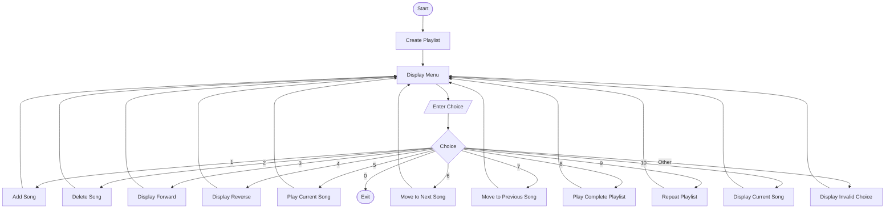
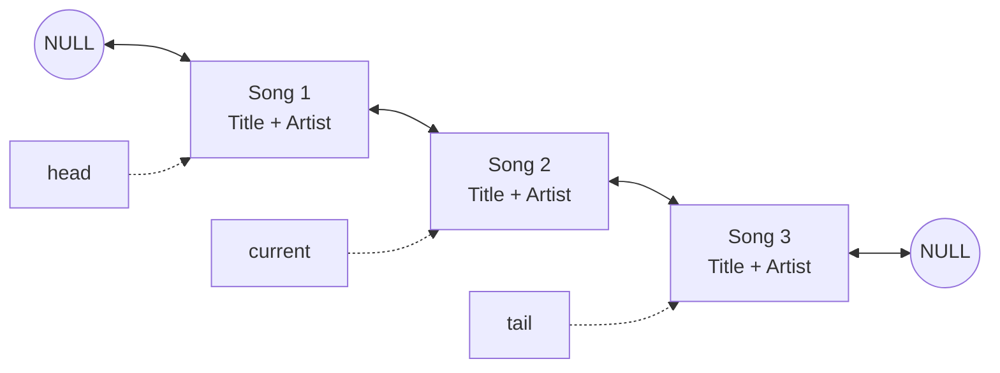
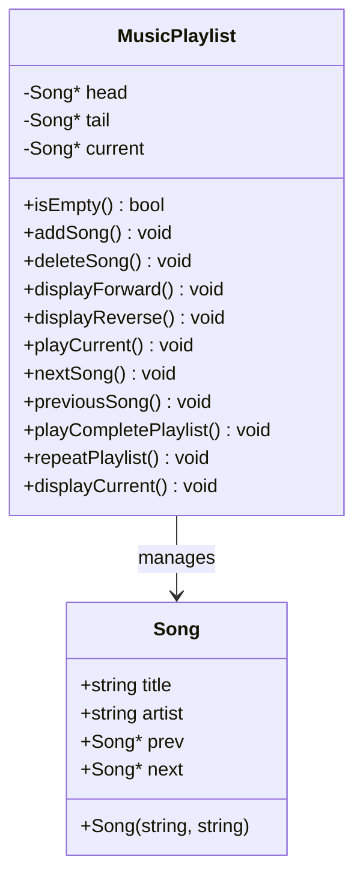

# Music Playlist Manager – Diagrams

## 1. Program Flowchart

## 2. Doubly Linked List Diagram

Each node stores song details and two links:
- `prev` points to the previous song.
- `next` points to the next song.

## 3. Class Diagram

